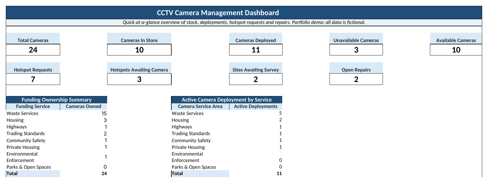
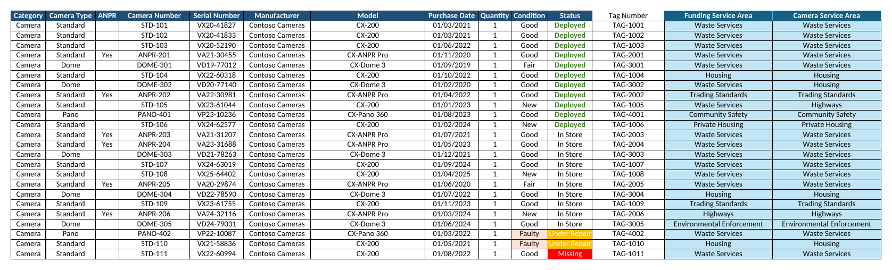

# CCTV Asset Management Dashboard (Excel)

An Excel workbook for tracking a fleet of redeployable CCTV cameras. It shows what stock is held, where each unit is deployed, which units are available or under repair, and how much demand for new locations is waiting. A dashboard updates automatically as records change.

**Author:** Stephen Hyde · [LinkedIn](https://www.linkedin.com/in/stephenhyde-data)

> [!NOTE]
> **This is a portfolio demo. All data is fictional.** It's based on a workbook I built for operational use in local-authority environmental enforcement. Every record in this version is invented:
> - **Cameras:** made by *Contoso Cameras* (Microsoft's standard fictional company name), with invented camera IDs, serials, tags and dates.
> - **Locations:** all in the fictional town of *Northbridge*.
> - **Services:** generic department names.
>
> The public version contains no network or IP details, no login or credential information, and no links to other files. The structure and dashboard logic match the original.



## The problem

The team managed a pool of mobile CCTV cameras that move between sites and between departments. Without a single record, simple questions were hard to answer quickly:

- How many cameras do we have, and how many are actually available right now?
- Where is each camera deployed, and since when?
- Which requested locations are still waiting for a camera or a site survey?
- Which units are faulty, away for repair or unaccounted for?
- Which department funds each camera, and which one is it currently deployed for?

## The solution

A linked workbook with one master asset register feeding operational logs and a status-driven dashboard.

| Sheet | Purpose |
|-------|---------|
| **Dashboard** | At-a-glance KPIs for stock, deployments, demand and repairs, plus ownership versus active deployment by department |
| **Inventory** | Master asset register: type, model, serial, condition, status, funding department and deploying department |
| **Deployments** | Live and historic deployments: location, dates, case reference, privacy impact assessment and ANPR flags |
| **Hotspot_Requests** | Requested locations, from the request through survey and approval to deployment |
| **Repairs_Fault_Log** | Faults, repair references, warranty claims, loan replacements and return dates |
| **Guide** | How to use and maintain each sheet |
| **Lists** | Controlled drop-down values that keep statuses consistent |



## Dashboard KPIs

| KPI | Logic |
|-----|-------|
| Total cameras | Cameras that aren't retired |
| In store / Deployed | Cameras by inventory status |
| Unavailable | Condition is *Faulty* or *Damaged*, **or** status is *Under Repair* or *Missing*. Each camera is counted once, even if several conditions apply |
| Available | Cameras in store, minus those in store that are faulty or damaged |
| Hotspot requests | Requests logged |
| Awaiting camera / Awaiting survey | Requests with no camera allocated / at *Pending Survey* |
| Open repairs | Repairs not yet *Fixed*, *Returned* or *Written Off* |
| Funding vs deployment | Cameras owned per department, compared with active deployments per department |

> [!TIP]
> **The tiles describe different things, so they can overlap.** *In Store* and *Deployed* show where a camera is, while *Unavailable* shows whether it can be used. A deployed camera that develops a fault counts in both *Deployed* and *Unavailable*. A faulty camera in store counts in *In Store* and *Unavailable*, but not *Available*.

## Excel techniques used

- **Structured tables** (`tblInventory`, `tblDeployments`, `tblHotspots`, `tblRepairs`), so formulas expand automatically as rows are added.
- **`SUMIFS` and `COUNTIFS`** for status-driven KPIs and department breakdowns.
- **`SUMPRODUCT` with multiple conditions** for the unavailable and available calculations. The `> 0` test makes sure a camera that is both faulty and under repair is counted once, not twice:

  ```excel
  =SUMPRODUCT(ISNUMBER(SEARCH("Camera",tblInventory[Category]))
     * tblInventory[Quantity]
     * --(((tblInventory[Condition]="Faulty") + (tblInventory[Condition]="Damaged")
          + (tblInventory[Status]="Under Repair") + (tblInventory[Status]="Missing")) > 0))
  ```

- **`INDEX` / `MATCH` lookups** pull each deployed camera's serial number from the register, so it's never typed twice:

  ```excel
  =IF([@[Camera Number]]="", "",
      IFERROR(INDEX(tblInventory[Serial Number],
                    MATCH([@[Camera Number]], tblInventory[Camera Number], 0)) & "", ""))
  ```

  The original workbook used `XLOOKUP` with `LET`. This public version uses `INDEX`/`MATCH` so it works in every Excel version.

- **Data validation drop-downs** driven by the Lists sheet, plus date validation, to keep data entry consistent.
- **Conditional formatting** that highlights deployed, under-repair and missing units.

## Testing

The dashboard was checked against an independent calculation of every KPI and department total. Edge cases were tested specifically to rule out double counting:

| Scenario | Expected behaviour | Result |
|----------|--------------------|--------|
| Camera both *Faulty* and *Under Repair* | Counted once in Unavailable | ✅ |
| Camera both *Missing* and *Damaged* | Counted once in Unavailable | ✅ |
| Deployed camera marked *Faulty* | Stays in Deployed and is added to Unavailable | ✅ |
| In-store camera marked *Damaged* | Stays in In Store, added to Unavailable, removed from Available | ✅ |
| Camera marked *Retired* | Removed from Total Cameras | ✅ |

## Outcome

The workbook gave the team one current view of camera stock, commitments, outstanding demand and repairs. That improved visibility of assets and supported better-informed deployment decisions.

## How to use it

1. Download [`CCTV_Camera_Management_Dashboard.xlsx`](CCTV_Camera_Management_Dashboard.xlsx).
2. Open it in Excel (any recent version) or LibreOffice Calc.
3. Start with the **Guide** sheet, then change a camera's status on the **Inventory** sheet to watch the dashboard update.

## Skills demonstrated

Spreadsheet design · data modelling with structured tables · KPI design and testing · multi-condition formulas · lookup functions · data validation · conditional formatting · operational reporting
